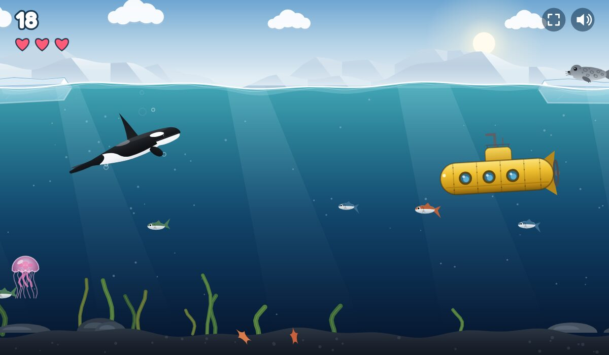
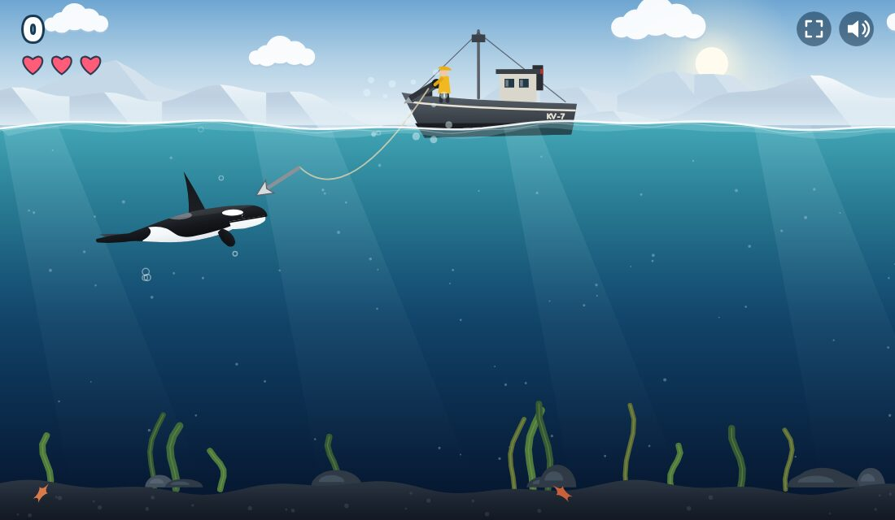

# Hungry Orca

An easy, slow Flappy-Bird-style game for kids. Swim as an orca in the Arctic, eat fish, knock seals off the ice, pop the rare sunfish, and avoid fishing nets, whalers' harpoons, submarines and jellyfish.

**Play:** https://dbugger85.github.io/hungry-orca/



## How to play

- Tap, click or press Space (or ↑, W, Enter) to swim up. The orca sinks slowly on its own.
- Fish: +1
- Swim right under an ice floe and the seal falls in. Catch it: +5
- Sunfish (rare): ram it, +10
- Watch out for the whaling ship: a red dotted line shows where the harpoon will fly.
- You have 3 lives and get one back every 50 points. A net rips when you hit it, but it still costs a life.
- On your last life, a net catches the orca; anything else turns it belly-up.
- The game gets slowly faster over time.

Works on computers, tablets and phones (best held sideways). The speaker button (or M) turns the sound off.



## Full screen and app

- **Full screen:** tap the corners button at the top right (or press F). On Android it also turns the screen sideways.
- **Install as an app (Android, Chrome, Edge):** tap **Install app** at the top of the start screen, or use the browser menu > *Install app* / *Add to Home screen*.
- **iPhone/iPad:** open the game in Safari, tap Share > **Add to Home Screen**. It then opens full screen from the home screen.
- Once installed, the game also works offline.

## Files

| File | What |
|---|---|
| `index.html` | The whole game: one file with a canvas and plain JavaScript, no build step, no libraries, no image or sound files (everything is drawn and synthesized in code). Open it in a browser to play locally |
| `manifest.webmanifest`, `sw.js`, `icons/` | Make it installable and playable offline. `icons/icon.svg` (rounded) and `icons/icon-square.svg` (full-bleed, for Android and iPhone) are the sources, in the same glass style as PrimeTime, ProPoker and ProQuiz |
| `test/` | `npm test` (quick checks) and `npm run screenshots` (pictures of set-up game scenes in `test/out/`) |
| `screenshots/` | The pictures in this README |
| `CLAUDE.md` | How the code works, for development with Claude Code |
| `PLAN.md` | The idea and every decision, dated |

## Development

```sh
npm test               # checks the game script, the app manifest, the icons and the offline file list
npm run screenshots    # screenshots of the game in set-up situations → test/out/ (needs Chromium)
npm start              # serves the game at http://localhost:8000
```

Remake the PNG icons after changing an SVG: `rsvg-convert -w 512 -h 512 icons/icon.svg -o icons/icon-512.png` (and 192; `icon-maskable-512.png` and the 180 px `apple-touch-icon.png` from `icon-square.svg`).

Pushing to `main` updates the live game in about a minute.
